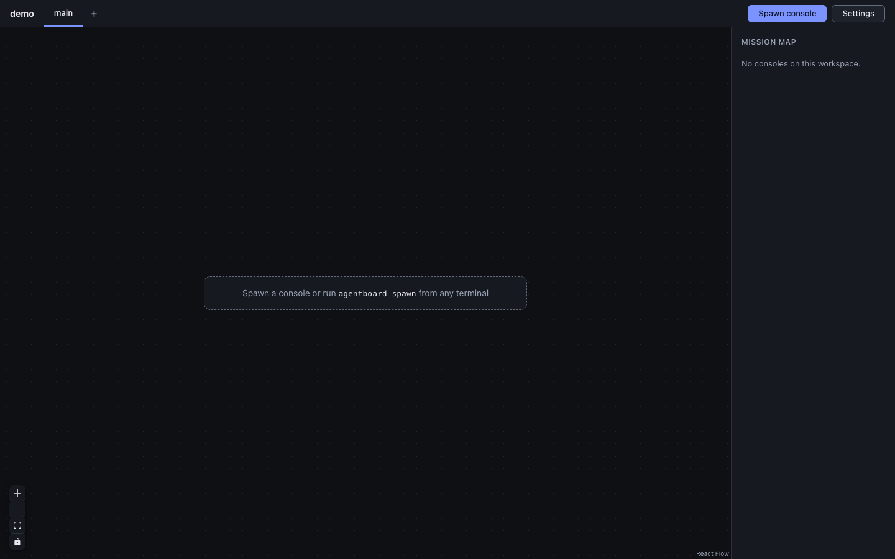
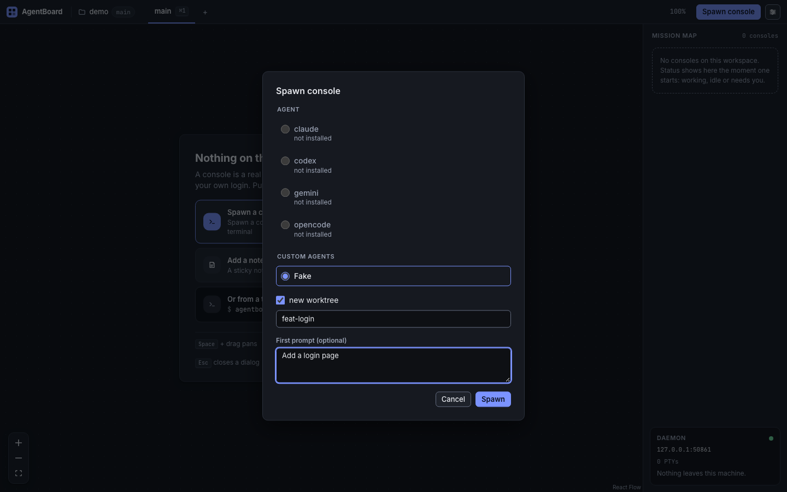
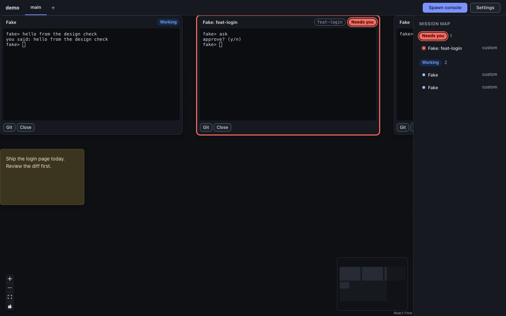
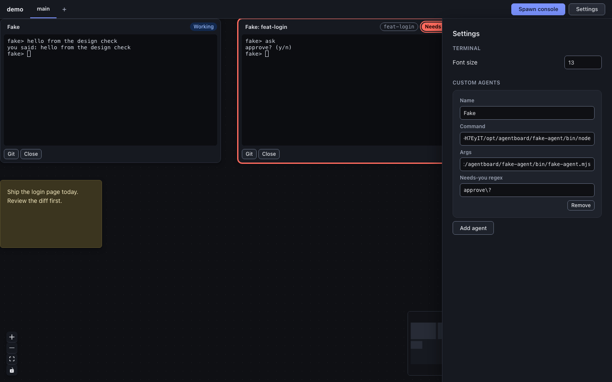
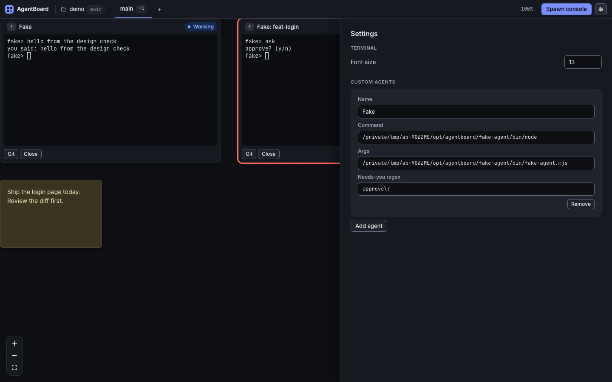
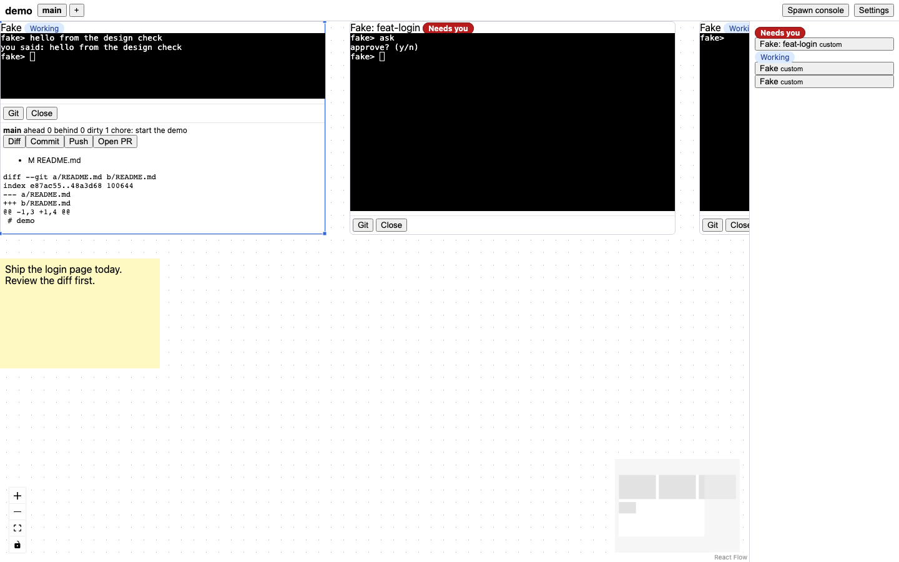
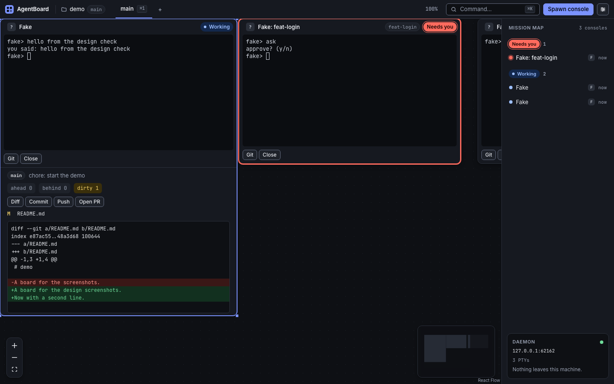
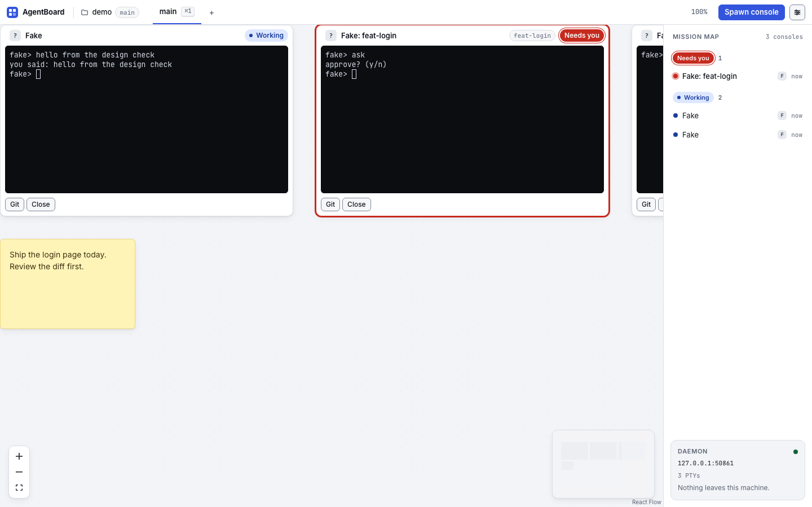
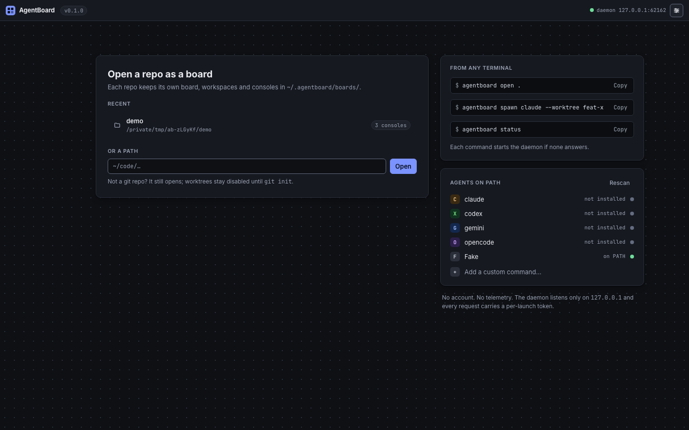

# AgentBoard design

The source is the owner's "AgentBoard Screens" canvas, row 01 (D45). Its eight artboards are plain HTML under [`screens/`](screens/), 1440x900 each: [Foundations](screens/Foundations.dc.html) (the token sheet), [Launch](screens/Launch.dc.html), [Board-Empty](screens/Board-Empty.dc.html), [Main](screens/Main.dc.html), [Spawn](screens/Spawn.dc.html), [Settings](screens/Settings.dc.html), [Console-States](screens/Console-States.dc.html) and [Hook-Setup](screens/Hook-Setup.dc.html). They load Inter and JetBrains Mono from Google Fonts for the canvas; the app itself bundles both fonts and fetches nothing.

Where the app departs from an artboard, on purpose:

- The launch page's primary button reads "Open", not "Open board", and there is no Browse button: the tests find the button by the name Open, and a browser's directory picker never reveals a folder's path.
- The zoom toolbar's third button is "Fit view", not "Fit to view" (the board tests match `/fit view/`), and has no Lock layout button.
- The rail's daemon card shows the address and the PTY count; GET /api/status reports neither the pid nor memory or CPU yet.
The board's look lives in three sheets under `packages/ui/src/styles`, imported once by `main.tsx` after the app so they follow React Flow's and xterm's own sheets:

- `tokens.css`: every colour, space, radius, font and control size as a CSS variable. Dark is the default; `prefers-color-scheme: light` swaps the colours.
- `base.css`: element defaults (in `:where()`, so any class wins), focus rings, and the shared primitives below. Other components use these instead of local copies.
- `app.css`: one section per component: launch page, app shell and top bar, empty board, overlays (spawn modal, settings drawer), React Flow on the tokens, console card, note, mission map, settings, git card and diff.

Components carry class names only; no colour or size is written inline. Roles, labels and accessible names are unchanged, so the tests and the e2e selectors still find everything.

## Primitives (base.css)

| Class | Look |
|---|---|
| `.btn` (every `<button>` by default) | 28 px tall, 6 px radius, 1 px `--color-border-strong`, raised surface, 13 px / 500 |
| `.btn-primary` | accent fill, `--color-on-accent` text, 600 |
| `.btn-quiet` | transparent, no border, muted text |
| `.btn-danger` | `--color-danger` border and text |
| `.btn-sm` | 24 px tall, 12 px text |
| `.btn-icon` | 28 x 28, needs an `aria-label` |
| `.input` (every text field by default) | 32 px tall, 6 px radius, `--color-bg` fill |
| `.card` | surface, 1 px `--color-border`, 10 px radius, `--shadow-card` |
| `.chip` | 20 px pill, mono 11 px, 1 px `--color-border`, muted |
| `.kbd` | 18 px key cap, mono 10 px, 2 px bottom border |
| `.pill` `.st-<status>` | 22 px, 12 / 600, a 6 px dot and a tint per status; `.st-needs_you` is solid, ringed (`0 0 0 2px` surface, `0 0 0 3px` needs-you) and has no dot. `StatusBadge` renders it. |
| `.mark` `.mark-<agent>` | the agent mark (below). `AgentMark` renders it. |
| `.label` | 11 / 600, caps, letter-spacing 0.06em, muted |
| `.caption` | 12, muted |
| `.mono` `.muted` `.sr-only` | monospace 12, muted text, visually hidden |

Icons are inline 14 px stroke SVGs with `aria-hidden` (`packages/ui/src/board/icons.tsx`), never emoji or a vendor logo. The logo is four squares, one in the accent.

## Type scale

| Use | Size / weight |
|---|---|
| Panel title (`.title`) | 20 / 700, letter-spacing -0.01em |
| Dialog title | 18 / 700 |
| Section (`.section-heading`) | 16 / 600 |
| Body | 14 |
| UI (buttons, rows) | 13 |
| Caption (`.caption`) | 12, muted |
| Label (`.label`) | 11 / 600, caps, 0.06em, muted |
| Terminal | 12 / 1.6, monospace |

## Agent marks

One 20 x 20 rounded square with an 11 px JetBrains Mono bold letter, `aria-hidden` (the agent's name always sits beside it). `<AgentMark agent="claude" />` for a built-in agent; any other string is a custom agent's name and shows its first letter. Marks are ANSI hues, never a vendor logo. They sit in the launch page's agent list, the mission map rows and at the left of the console header (which draws its own for now, with `?` for a custom agent).

| Agent | Letter | Dark fg / bg | Light fg / bg |
|---|---|---|---|
| claude | C | `#f2c98a` / `#3a2a12` | `#6b4500` / `#fdf0c2` |
| codex | X | `#7ee787` / `#10331f` | `#13623a` / `#d9f5e3` |
| gemini | G | `#9dbfff` / `#13284d` | `#1d3f9e` / `#dde7ff` |
| opencode | O | `#d2a8ff` / `#2c1f4a` | `#5a2ca0` / `#ece0ff` |
| custom | first letter | `#c0c6d1` / `#2a2f39` | `#3c4350` / `#e6e9ee` |

## Keyboard

| Key | Does | Where |
|---|---|---|
| ⌘1 to ⌘9 | switch to that workspace (each tab shows its key cap) | anywhere but a focused terminal or field |
| ⌘⇧N | open the spawn dialog | anywhere (a browser may keep it: Chrome opens a private window) |
| N | add a note in the middle of the view | anywhere but a focused terminal or field |
| Esc | close the spawn dialog or the settings drawer; focus goes back to the opener | the drawer ignores an Escape typed into a terminal |

Controls inside the board (zoom buttons, mission-map rows, empty-board actions, tabs) draw their focus ring inset, so the canvas edge never clips it.

## Tokens

| Group | Token | Value |
|---|---|---|
| Space (8 px grid) | `--space-half` `--space-1` `--space-2` `--space-3` `--space-4` `--space-6` | 4 8 16 24 32 48 px |
| Radius | `--radius-xs` `--radius-sm` `--radius-lg` `--radius-pill` | 2 px (resize handles), 6 px (controls, terminal, notes), 10 px (cards, modal), 999 px (pills); marks 5 px and key caps 4 px, as Foundations draws them |
| Font | `--font-sans` | "Inter Variable", Inter, system-ui, … (bundled with `@fontsource-variable/inter`; nothing is fetched at run time) |
| | `--font-mono` | "JetBrains Mono Variable", "JetBrains Mono", ui-monospace, Menlo, … (bundled the same way; the terminal keeps `Menlo, monospace`) |
| | `--text-2xs` `--text-xs` `--text-sm` `--text-md` `--text-lg` `--text-xl` | 11 12 13 14 16 20 px |
| Controls | `--control-height` `--control-height-sm` `--input-height` | 28 24 32 px |
| | `--chip-height` `--pill-height` `--kbd-height` `--mark-size` | 20 22 18 20 px |
| Layout | `--topbar-height` `--rail-width` `--drawer-width` | 44 264 640 px |

| Colour | Dark (default) | Light |
|---|---|---|
| `--color-bg` | `#0e1014` | `#f3f4f7` |
| `--color-surface` | `#161920` | `#ffffff` |
| `--color-surface-raised` | `#1e222a` | `#f6f7f9` |
| `--color-surface-hover` | `#262b35` | `#eceef2` |
| `--color-border` | `#2b303b` | `#dcdfe6` |
| `--color-border-strong` (control borders, 3:1) | `#646c80` | `#7f8798` |
| `--color-text` | `#e7e9ee` | `#171a21` |
| `--color-text-muted` | `#9ba3b4` | `#5b6475` |
| `--color-accent` (the one accent) | `#7b93ff` | `#3355dd` |
| `--color-on-accent` | `#0b1020` | `#ffffff` |
| `--color-danger` | `#ff8a80` | `#c62a1f` |
| `--term-bg` / `--term-fg` (both themes) | `#0b0d11` / `#d9dee8` | same |
| `--term-ansi-*` (16 ANSI colours, passed to xterm's theme) | black `#20242c`, red `#ff7b72`, green `#7ee787`, yellow `#e3c76b`, blue `#79a6ff`, magenta `#d2a8ff`, cyan `#76e3ea`, white `#d9dee8`; bright: black `#8b949e`, red `#ffa198`, green `#a5f0b0`, yellow `#f2d98a`, blue `#a5c4ff`, magenta `#e2c5ff`, cyan `#b3f0f5`, white `#ffffff` | same |
| `--note-bg` / `--note-fg` | `#3b3520` / `#f4e9bf` | `#fff4b8` / `#3a3110` |
| `--diff-added-fg` / `-bg` | `#6fdc9a` / `#12301f` | `#116329` / `#dcf5e3` |
| `--diff-removed-fg` / `-bg` | `#ff9a90` / `#3a1716` | `#a40e26` / `#ffe3e1` |
| `--status-starting-fg` / `-bg` | `#f5d36b` / `#3a2f0b` | `#6b4500` / `#fdf0c2` |
| `--status-working-fg` / `-bg` | `#9dbfff` / `#13284d` | `#1d3f9e` / `#dde7ff` |
| `--status-idle-fg` / `-bg` | `#6fdc9a` / `#10331f` | `#13623a` / `#d9f5e3` |
| `--status-needs-you-fg` / `-bg` | `#1f0604` / `#ff6b5e` | `#ffffff` / `#c62a1f` |
| `--status-stopped-fg` / `-bg` | `#c0c6d1` / `#2a2f39` | `#3c4350` / `#e6e9ee` |
| `--status-exited-fg` / `-bg` | `#a3abbb` / `#22262e` | `#555e6e` / `#eceef2` |

Needs you is the loudest state on screen: a solid fill (every other status is a tint), bold, ringed; its console card gets a 2 px ring in the same colour and its mission-map dot a halo.

## Contrast (WCAG AA, 4.5:1 for text)

`node docs/design/contrast.mjs` prints this table from `tokens.css` and exits non-zero if any pair drops below 4.5:1.

| Pair | Dark | Light |
|---|---|---|
| `--color-text` on `--color-bg` | 15.7:1 | 15.8:1 |
| `--color-text` on `--color-surface` | 14.5:1 | 17.4:1 |
| `--color-text` on `--color-surface-raised` | 13.1:1 | 16.2:1 |
| `--color-text` on `--color-surface-hover` | 11.7:1 | 15.0:1 |
| `--color-text-muted` on `--color-bg` | 7.5:1 | 5.4:1 |
| `--color-text-muted` on `--color-surface` | 6.9:1 | 6.0:1 |
| `--color-text-muted` on `--color-surface-raised` | 6.3:1 | 5.6:1 |
| `--color-on-accent` on `--color-accent` | 6.7:1 | 6.0:1 |
| `--color-on-accent` on `--color-accent-hover` | 8.6:1 | 7.6:1 |
| `--color-accent` on `--color-surface` | 6.2:1 | 6.0:1 |
| `--color-danger` on `--color-surface` | 7.7:1 | 5.6:1 |
| `--term-fg` on `--term-bg` | 14.4:1 | 14.4:1 |
| `--note-fg` on `--note-bg` | 10.1:1 | 11.6:1 |
| `--diff-added-fg` on `--diff-added-bg` | 8.4:1 | 6.4:1 |
| `--diff-removed-fg` on `--diff-removed-bg` | 7.8:1 | 6.5:1 |
| `--status-starting-fg` on `--status-starting-bg` | 9.1:1 | 7.4:1 |
| `--status-working-fg` on `--status-working-bg` | 7.9:1 | 7.5:1 |
| `--status-idle-fg` on `--status-idle-bg` | 8.2:1 | 6.4:1 |
| `--status-needs-you-fg` on `--status-needs-you-bg` | 6.9:1 | 5.6:1 |
| `--status-stopped-fg` on `--status-stopped-bg` | 7.8:1 | 8.2:1 |
| `--status-exited-fg` on `--status-exited-bg` | 6.6:1 | 5.6:1 |
| `--term-ansi-red` / `bright-red` on `--term-bg` | 7.7 / 10.0:1 | same |
| `--term-ansi-green` / `bright-green` on `--term-bg` | 12.7 / 14.5:1 | same |
| `--term-ansi-yellow` / `bright-yellow` on `--term-bg` | 11.7 / 14.0:1 | same |
| `--term-ansi-blue` / `bright-blue` on `--term-bg` | 8.1 / 11.1:1 | same |
| `--term-ansi-magenta` / `bright-magenta` on `--term-bg` | 10.0 / 12.7:1 | same |
| `--term-ansi-cyan` / `bright-cyan` on `--term-bg` | 12.9 / 15.5:1 | same |
| `--term-ansi-white` / `bright-white` on `--term-bg` | 14.4 / 19.4:1 | same |
| `--term-ansi-bright-black` on `--term-bg` | 6.3:1 | same |
| `--mark-claude-fg` on `--mark-claude-bg` | 8.9:1 | 7.4:1 |
| `--mark-codex-fg` on `--mark-codex-bg` | 9.0:1 | 6.4:1 |
| `--mark-gemini-fg` on `--mark-gemini-bg` | 7.9:1 | 7.5:1 |
| `--mark-opencode-fg` on `--mark-opencode-bg` | 7.7:1 | 7.2:1 |
| `--mark-custom-fg` on `--mark-custom-bg` | 7.8:1 | 8.2:1 |

ANSI black is left out on purpose: programs paint it as a background.

Non-text (WCAG 1.4.11, 3:1): `--color-border-strong`, the border of every button and input, is 3.3:1 on the surface and 3.6:1 on the page in dark, 3.6:1 and 3.3:1 in light.

Placeholders use `--color-text-muted` (inputs sit on `--color-bg`: 7.5:1 dark, 5.4:1 light), since "branch name" and "Commit message" have no other visible label.

Focus: every button, input, link and tabbable element shows a 2 px `--color-accent` outline on `:focus-visible` (6.2:1 and 6.0:1 against the surface). A focused console or note node gets the same ring, rounded to the card. The spawn modal moves focus to the first installed agent when it opens and closes on Escape, Cancel or a backdrop click.

## Screenshots

1440x900, headless Chromium, a real daemon on a temp repo named `demo` under `/tmp`, the fake agent as the only agent and an empty agent PATH (D31, D38). Retake them with:

```sh
npm run build
npx playwright test -c docs/design/playwright.config.ts            # the current set
SHOTS=before npx playwright test -c docs/design/playwright.config.ts # before-*.png, on an older build
```

| | Before | After |
|---|---|---|
| Empty board |  |  |
| Spawn dialog |  |  |
| Three consoles and a note |  |  |
| Settings |  |  |
| Git card |  |  |
| Light theme | |  |
| Launch page | |  |

The before column is the board as it stood after L1A to L1C (v0.1.0); the after column is the redesign from the Screens canvas.
