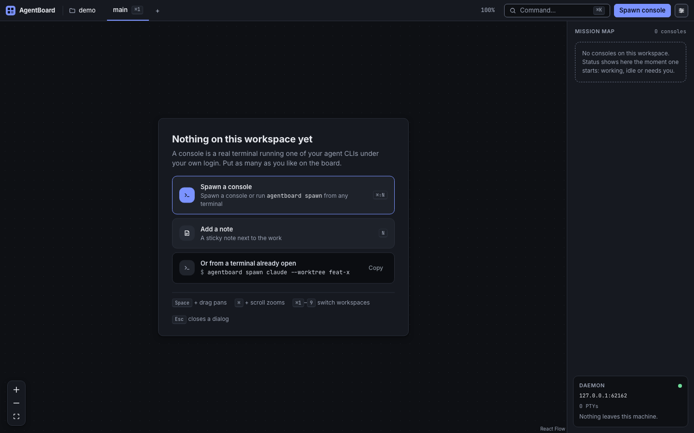
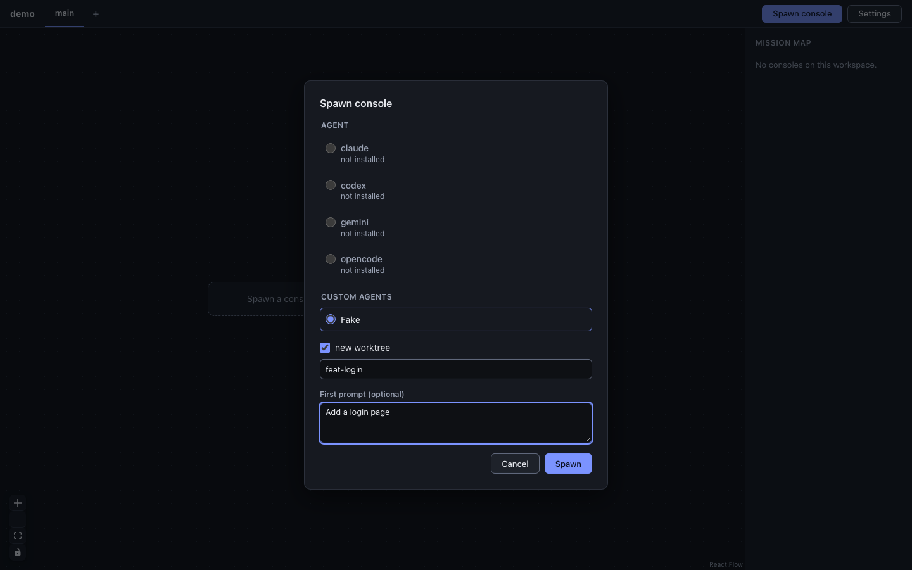
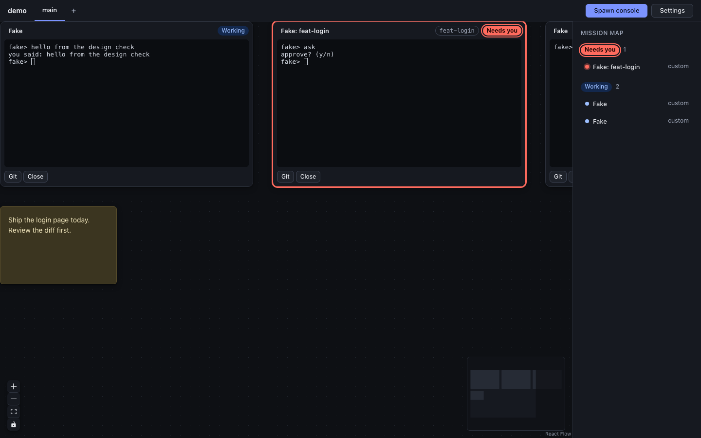
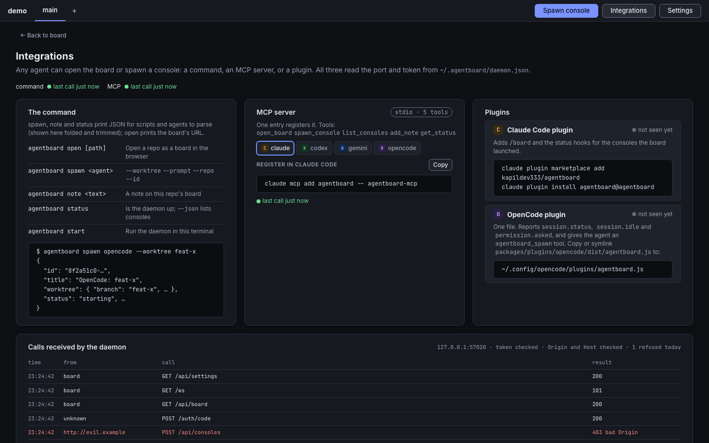

# AgentBoard design

The board's look lives in the sheets under `packages/ui/src/styles`, imported once by `main.tsx` after the app so they follow React Flow's and xterm's own sheets:

- `tokens.css`: every colour, space, radius and font as a CSS variable. Dark is the default; `prefers-color-scheme: light` swaps the colours.
- `base.css`: element defaults (in `:where()`, so any class wins), buttons (`.btn-primary`, `.btn-sm`, `.btn-icon`), inputs, focus rings, chips, field labels, the path field.
- `integrations.css`: the Integrations page, imported by its component.
- `app.css`: one section per component: app shell and top bar, overlays (spawn modal, settings drawer), React Flow on the tokens, status badge, console card, note, mission map, settings, git card and diff.

Components carry class names only; no colour or size is written inline. Roles, labels and accessible names are unchanged, so the tests and the e2e selectors still find everything.

## Tokens

| Group | Token | Value |
|---|---|---|
| Space (8 px grid) | `--space-half` `--space-1` `--space-2` `--space-3` `--space-4` `--space-6` | 4 8 16 24 32 48 px |
| Radius | `--radius-xs` `--radius-sm` `--radius-lg` `--radius-pill` | 2 px (resize handles), 6 px (controls, terminal, notes), 10 px (cards, modal), 999 px (pills) |
| Font | `--font-sans` | Inter (self-hosted from `@fontsource-variable/inter`), then the system-ui stack |
| | `--font-mono` | JetBrains Mono (`@fontsource-variable/jetbrains-mono`), then ui-monospace, Menlo, …; the terminal uses it too |
| | `--text-2xs` `--text-xs` `--text-sm` `--text-md` `--text-lg` `--text-xl` | 11 (caps labels) 12 13 14 16 20 (panel titles) px |
| Layout | `--topbar-height` `--rail-width` `--drawer-width` | 44 264 400 px |

| Colour | Dark (default) | Light |
|---|---|---|
| `--color-bg` | `#0e1014` | `#f3f4f7` |
| `--color-surface` | `#161920` | `#ffffff` |
| `--color-surface-raised` | `#1e222a` | `#f6f7f9` |
| `--color-surface-hover` | `#262b35` | `#eceef2` |
| `--color-border` | `#2b303b` | `#dcdfe6` |
| `--color-border-strong` (control borders, 3:1) | `#646c80` | `#7f8798` |
| `--color-text` | `#e7e9ee` | `#171a21` |
| `--color-text-muted` | `#9ba3b4` | `#5b6475` |
| `--color-accent` (the one accent) | `#7b93ff` | `#3355dd` |
| `--color-on-accent` | `#0b1020` | `#ffffff` |
| `--color-danger` | `#ff8a80` | `#c62a1f` |
| `--term-bg` / `--term-fg` (both themes) | `#0b0d11` / `#d9dee8` | same |
| `--term-ansi-*` (16 ANSI colours, passed to xterm's theme) | black `#20242c`, red `#ff7b72`, green `#7ee787`, yellow `#e3c76b`, blue `#79a6ff`, magenta `#d2a8ff`, cyan `#76e3ea`, white `#d9dee8`; bright: black `#8b949e`, red `#ffa198`, green `#a5f0b0`, yellow `#f2d98a`, blue `#a5c4ff`, magenta `#e2c5ff`, cyan `#b3f0f5`, white `#ffffff` | same |
| `--note-bg` / `--note-fg` | `#3b3520` / `#f4e9bf` | `#fff4b8` / `#3a3110` |
| `--diff-added-fg` / `-bg` | `#6fdc9a` / `#12301f` | `#116329` / `#dcf5e3` |
| `--diff-removed-fg` / `-bg` | `#ff9a90` / `#3a1716` | `#a40e26` / `#ffe3e1` |
| `--status-starting-fg` / `-bg` | `#f5d36b` / `#3a2f0b` | `#6b4500` / `#fdf0c2` |
| `--status-working-fg` / `-bg` | `#9dbfff` / `#13284d` | `#1d3f9e` / `#dde7ff` |
| `--status-idle-fg` / `-bg` | `#6fdc9a` / `#10331f` | `#13623a` / `#d9f5e3` |
| `--status-needs-you-fg` / `-bg` | `#1f0604` / `#ff6b5e` | `#ffffff` / `#c62a1f` |
| `--status-stopped-fg` / `-bg` | `#c0c6d1` / `#2a2f39` | `#3c4350` / `#e6e9ee` |
| `--status-exited-fg` / `-bg` | `#a3abbb` / `#22262e` | `#555e6e` / `#eceef2` |
| `--mark-claude-fg` / `-bg` | `#f2c98a` / `#3a2a12` | `#6b4500` / `#fdf0c2` |
| `--mark-codex-fg` / `-bg` | `#7ee787` / `#10331f` | `#13623a` / `#d9f5e3` |
| `--mark-gemini-fg` / `-bg` | `#9dbfff` / `#13284d` | `#1d3f9e` / `#dde7ff` |
| `--mark-opencode-fg` / `-bg` | `#d2a8ff` / `#2c1f4a` | `#5a2ca0` / `#ece0ff` |
| `--mark-custom-fg` / `-bg` | `#c0c6d1` / `#2a2f39` | `#3c4350` / `#e6e9ee` |

Agent marks are a 20 px monogram (`.mark.mark-<agent>`: C, X, G, O, ?) in an ANSI hue at the left of the console header, never a vendor logo.

Needs you is the loudest state on screen: a solid fill (every other status is a tint), bold, ringed; its console card gets a 2 px ring in the same colour and its mission-map dot a halo.

## Contrast (WCAG AA, 4.5:1 for text)

`node docs/design/contrast.mjs` prints this table from `tokens.css` and exits non-zero if any pair drops below 4.5:1.

| Pair | Dark | Light |
|---|---|---|
| `--color-text` on `--color-bg` | 15.7:1 | 15.8:1 |
| `--color-text` on `--color-surface` | 14.5:1 | 17.4:1 |
| `--color-text` on `--color-surface-raised` | 13.1:1 | 16.2:1 |
| `--color-text` on `--color-surface-hover` | 11.7:1 | 15.0:1 |
| `--color-text-muted` on `--color-bg` | 7.5:1 | 5.4:1 |
| `--color-text-muted` on `--color-surface` | 6.9:1 | 6.0:1 |
| `--color-text-muted` on `--color-surface-raised` | 6.3:1 | 5.6:1 |
| `--color-on-accent` on `--color-accent` | 6.7:1 | 6.0:1 |
| `--color-on-accent` on `--color-accent-hover` | 8.6:1 | 7.6:1 |
| `--color-accent` on `--color-surface` | 6.2:1 | 6.0:1 |
| `--color-danger` on `--color-surface` | 7.7:1 | 5.6:1 |
| `--term-fg` on `--term-bg` | 14.4:1 | 14.4:1 |
| `--note-fg` on `--note-bg` | 10.1:1 | 11.6:1 |
| `--diff-added-fg` on `--diff-added-bg` | 8.4:1 | 6.4:1 |
| `--diff-removed-fg` on `--diff-removed-bg` | 7.8:1 | 6.5:1 |
| `--status-starting-fg` on `--status-starting-bg` | 9.1:1 | 7.4:1 |
| `--status-working-fg` on `--status-working-bg` | 7.9:1 | 7.5:1 |
| `--status-idle-fg` on `--status-idle-bg` | 8.2:1 | 6.4:1 |
| `--status-needs-you-fg` on `--status-needs-you-bg` | 6.9:1 | 5.6:1 |
| `--status-stopped-fg` on `--status-stopped-bg` | 7.8:1 | 8.2:1 |
| `--status-exited-fg` on `--status-exited-bg` | 6.6:1 | 5.6:1 |
| `--term-ansi-red` / `bright-red` on `--term-bg` | 7.7 / 10.0:1 | same |
| `--term-ansi-green` / `bright-green` on `--term-bg` | 12.7 / 14.5:1 | same |
| `--term-ansi-yellow` / `bright-yellow` on `--term-bg` | 11.7 / 14.0:1 | same |
| `--term-ansi-blue` / `bright-blue` on `--term-bg` | 8.1 / 11.1:1 | same |
| `--term-ansi-magenta` / `bright-magenta` on `--term-bg` | 10.0 / 12.7:1 | same |
| `--term-ansi-cyan` / `bright-cyan` on `--term-bg` | 12.9 / 15.5:1 | same |
| `--term-ansi-white` / `bright-white` on `--term-bg` | 14.4 / 19.4:1 | same |
| `--term-ansi-bright-black` on `--term-bg` | 6.3:1 | same |
| `--mark-claude-fg` on `--mark-claude-bg` | 8.9:1 | 7.4:1 |
| `--mark-codex-fg` on `--mark-codex-bg` | 9.0:1 | 6.4:1 |
| `--mark-gemini-fg` on `--mark-gemini-bg` | 7.9:1 | 7.5:1 |
| `--mark-opencode-fg` on `--mark-opencode-bg` | 7.7:1 | 7.2:1 |
| `--mark-custom-fg` on `--mark-custom-bg` | 7.8:1 | 8.2:1 |

ANSI black is left out on purpose: programs paint it as a background.

Non-text (WCAG 1.4.11, 3:1): `--color-border-strong`, the border of every button and input, is 3.3:1 on the surface and 3.6:1 on the page in dark, 3.6:1 and 3.3:1 in light.

Placeholders use `--color-text-muted` (inputs sit on `--color-bg`: 7.5:1 dark, 5.4:1 light), since "branch name" and "Commit message" have no other visible label.

Focus: every button, input, link and tabbable element shows a 2 px `--color-accent` outline on `:focus-visible` (6.2:1 and 6.0:1 against the surface). A focused console or note node gets the same ring, rounded to the card. The spawn modal moves focus to the first installed agent when it opens and closes on Escape, Cancel or a backdrop click.

## Screenshots

1440x900, headless Chromium, a real daemon on a temp repo named `demo` under `/tmp`, the fake agent as the only agent and an empty agent PATH (D31, D38). Retake them with:

```sh
npm run build
npx playwright test -c docs/design/playwright.config.ts            # the current set
SHOTS=before npx playwright test -c docs/design/playwright.config.ts # before-*.png, on an older build
```

| | Before | After |
|---|---|---|
| Empty board |  |  |
| Spawn dialog |  |  |
| Three consoles and a note |  |  |
| Settings |  |  |
| Git card |  |  |
| Light theme | |  |
| Integrations: the command, MCP and plugin cards and the daemon's call log, one refused Origin in the danger colour (`-g integrations` retakes it alone) | |  |
